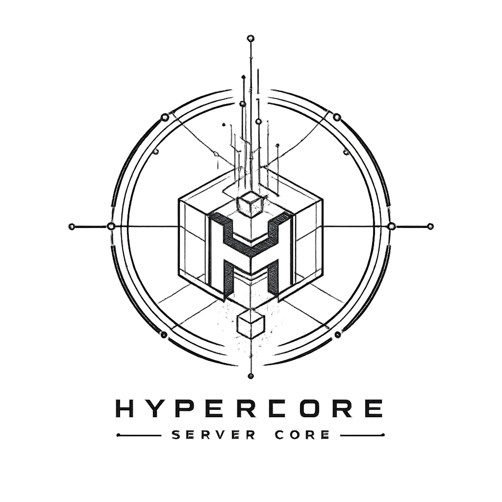

<p align="center">
  
</p>

<h1 align="center">HyperCore</h1>

<p align="center">
  <a href="https://www.java.com/"></a>
  <a href="https://gradle.org/"></a>
  <a href="https://www.minecraft.net/"></a>
  <a href="https://www.vulkan.org/"></a>
  <a href="./LICENSE"></a>
</p>

HyperCore is an experimental independent Minecraft server core. It starts from
Mojang's official Minecraft `26.1` server bundle and applies HyperCore patches
through a reproducible paperweight pipeline. It is not a fork of Paper.

## Status

What works today:

- The full offline patch pipeline: Mache decompile, patch application, patch
  rebuild, and bundler JAR generation all succeed from cached dependencies.
- The patched server compiles and packages into
  `hypercore-server-bundler-0.1.0-SNAPSHOT.jar`.
- Unit tests cover the region mailbox scheduler, the runtime boundaries
  (mutation queue, plugin lifecycle rollback, compute fallback), and the
  optional Vulkan provider.

What is explicitly not done yet:

- A real server start with EULA acceptance, world load, and gameplay ticks has
  never been executed. The core cannot be called runnable until that smoke
  test passes.
- No claim is made that ordinary Bukkit/Paper plugins or Fabric/Forge mods run
  directly on this server.

## Architecture

### Region execution

Immutable region snapshots are planned on bounded worker lanes. Workers return
value-only mutations (`RegionMutation` records that cannot retain NMS
objects), which the server thread validates and applies at a later tick
boundary through `ServerMutationQueue`:

- `applyAtTickBoundary` is server-thread-only and drains the whole batch.
- `set-block` application re-checks region ownership, world bounds, and
  chunk-loaded state; unknown block IDs are rejected through the registry's
  optional lookup.
- Worker tasks may only emit mutations for their own region, so lane ownership
  cannot be bypassed.
- Malformed worker output is dropped, never allowed to abort a server tick.

Vanilla level, entity, block, and chunk ticks remain server-thread work until
a full region-ownership migration exists.

### Plugins

A narrow `plugin.yml` discovery runtime runs on the server thread with
child-first JAR class loading, hard/soft dependency ordering, lifecycle
callbacks, commands, next-tick tasks, and typed events. A failed activation is
rolled back: commands, listeners, and pending tasks registered by the broken
plugin are removed. External cancellation from other threads is deferred to a
tick boundary. This is not Bukkit or Paper binary compatibility;
`BukkitCompatibilityBridge` exposes an intentionally small facade.

### Loader compatibility

The standalone core owns a neutral provider SPI
(`LoaderCompatibilityRegistry`) whose per-provider failures are isolated from
the server lifecycle. Optional Fabric and Forge adapters must remain outside
the server JAR because their launchers cannot coexist inside one Minecraft
server class loader.

### Compute

CPU execution is always available and deterministic: `ComputeService` ships
`identity`, f64 `squared-length-3d`, and explicit-f32
`squared-length-3d-f32`. An optional Vulkan provider is discovered through
`ServiceLoader` — from the classpath or from `compute-providers/` via an
isolated URLClassLoader — for explicitly f32 batch operations. Native
failures fall back to the CPU path and never prevent startup or shutdown. GPU
compute never accelerates arbitrary Minecraft simulation.

## Repository Layout

| Path | Purpose |
| --- | --- |
| `server-paperweight/` | The standalone server build (current mainline). |
| `server-paperweight/hypercore-server/` | Bundler JAR assembly, source/resource/feature patch lifecycle, generated Mojang worktrees under `src/minecraft/`. |
| `server-paperweight/hypercore-vulkan-provider/` | Optional ServiceLoader compute provider with its own LWJGL, Shaderc, and SPIR-V kernel. |
| `server-paperweight/paper-server/patches/` | HyperCore source patches. `paper-server` is only paperweight's required layout name; it contains no Paper code. Its generated `com/` and `net/` worktrees must never be committed. |
| `core/`, `fabric/`, `forge/` | Legacy multi-loader projects (Minecraft 1.21.1). Not runtime dependencies of the standalone server; kept only while reusable contracts migrate out of them. |
| `AUDIT_AND_FIXES.md` | Code-review findings, fixes, API existence checks, and rebuild evidence. |
| `BENCHMARKS.md` | Measured compute/scheduler calibration data and the Paper vs Folia comparison. |
| `COMPATIBILITY.md` | Tested compatibility matrix (no aspirational claims). |
| `FABRIC_MOD_WHITELIST.md` | Policy for Fabric mods in the orchestrated dual-server deployment. |

## Build

Install JDK 25, then run the standalone project:

```powershell
Set-Location server-paperweight
./gradlew.bat :hypercore-server:setupMacheSources `
  :hypercore-server:applyPatches `
  :hypercore-server:rebuildPatches `
  :hypercore-server:createBundlerJar `
  --offline --no-daemon
```

The output is:

```text
server-paperweight/hypercore-server/build/libs/hypercore-server-bundler-0.1.0-SNAPSHOT.jar
```

`--offline` works after the Mojang bundle, Mache, and Gradle dependencies are
cached. The repository configures `127.0.0.1:7892` for required downloads; run
the initial dependency resolution only while that proxy is available.

## Test

```powershell
Set-Location server-paperweight
./gradlew.bat :hypercore-server:test `
  :hypercore-vulkan-provider:test --offline --no-daemon
```

Current baseline: 6 runtime-boundary tests, 5 region-mailbox-scheduler tests,
and 5 Vulkan-provider tests, all passing.

## Optional Vulkan Provider

Build the native provider separately:

```powershell
Set-Location server-paperweight
./gradlew.bat :hypercore-vulkan-provider:assembleProviderDirectory --offline --no-daemon
```

Copy the contents of
`hypercore-vulkan-provider/build/compute-providers` into the server's
`compute-providers` directory, or pass
`-Dhypercore.compute.providers=<directory>`. Missing drivers, unsupported
devices, and native failures fall back to the deterministic CPU implementation.

## Current Verification Boundary

The patch pipeline, bundler generation, and unit tests run from cached
dependencies. A full server startup, EULA acceptance, world load, and gameplay
tick smoke test are still required before the standalone core can be called
runnable. See [AUDIT_AND_FIXES.md](AUDIT_AND_FIXES.md) for the latest review
evidence and [COMPATIBILITY.md](COMPATIBILITY.md) for what is actually tested.

See [server-paperweight/README.md](server-paperweight/README.md) for the
paperweight worktree model, patch lifecycle, and provider installation details.

## License

Apache License 2.0. Minecraft is a trademark of Microsoft. HyperCore is not
affiliated with Mojang Studios or Microsoft.
